# DYSTOPIA

Loja de peças de PC e serviços técnicos (montagem, manutenção, formatação e
desenvolvimento de software), projetada e construída por **Flávio Victor** como
projeto de portfólio. O foco técnico é o checkout: uma **SAGA** orquestrada
sobre **RabbitMQ**, com outbox transacional, retentativa planejada, DLQ e
compensação — o pedido nunca fica pela metade.

**Demo:** <https://dystopia-wheat.vercel.app> — conta de cliente
`cliente@dystopia.dev` / `cliente123`. Peças reais, preços fictícios, nada é
cobrado. No checkout, o modo demonstração deixa escolher o que o gateway
responde (aprovar, recusar, instável, fora do ar) para ver a saga reagir.

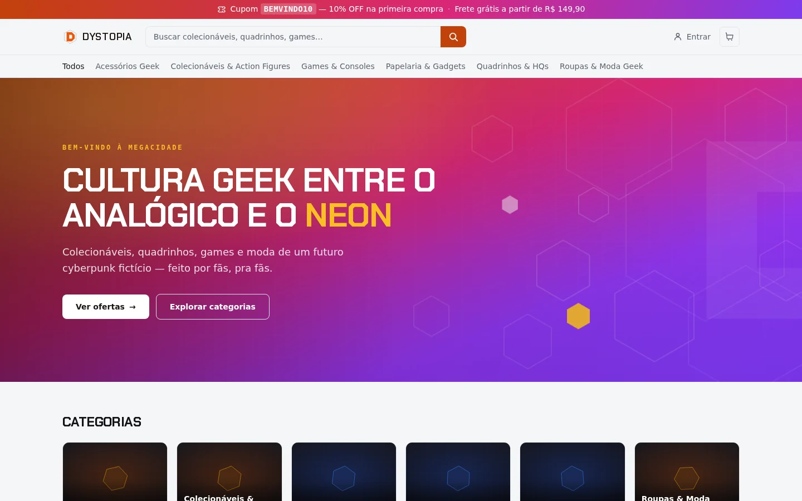

## Destaques

- **Checkout em seis passos atômicos** (estoque, pagamento, cupom,
  confirmação, carrinho, aviso), cada um num serviço. Se um falha de vez, os
  anteriores são desfeitos em ordem reversa.
- **RabbitMQ com outbox transacional**: a mensagem nasce no mesmo commit do
  pedido e um relay publica com *publisher confirm*. Retry com backoff em
  filas de espera (TTL + dead-letter exchange), DLQ com reprocessamento no
  painel admin, reconciliação automática.
- **Pagamentos em processo e banco próprios**, falando com a saga só por
  mensagem; cartão real pelo Stripe em modo de teste.
- **Concorrência tratada no banco**: carrinho e cadastro são uma instrução
  atômica (`INSERT … ON CONFLICT`), estoque sai com `UPDATE` condicional.
- **Busca full-text** do Postgres (português, sem acento, por prefixo,
  ordenada por relevância) com índice GIN; listagens paginadas.
- **Testado de verdade**: unitários, integração contra Postgres e RabbitMQ
  reais (broker fora, reconexão, consumidor que morre sem `ack`, estoque e
  carrinho sob concorrência, migrations com dados antigos) e navegador com
  Playwright em desktop e celular: compras (aprovada, recusada, instável, com
  cupom, e pelo Stripe real em modo de teste), conta, carrinho, orçamento, admin, isolamento entre clientes e
  acessibilidade (axe, WCAG 2.1 AA). Testes de arquitetura impedem serviço de
  importar serviço, Server Action de escrever no banco ou abrir transação, a
  borda de conhecer a fila e action do admin sem checagem de papel.
- **Assistente com IA que usa o próprio sistema**: busca no catálogo, consulta
  o pedido de quem está logado e registra orçamento por ferramentas (tool
  calling), com a identidade vinda da sessão — nunca da conversa.
- **Pronto para ficar exposto**: CSP com nonce por request, limite de
  tentativas no login, login que não revela quais e-mails existem, sessão no
  banco (sair vale na hora, em qualquer aparelho), **MFA obrigatório no
  painel** (TOTP com códigos de recuperação) e o app conectando no banco com
  um usuário que não consegue apagar tabela.

## Telas

| Pedido confirmado: a saga passo a passo | Pagamento recusado: tudo desfeito |
|---|---|
| 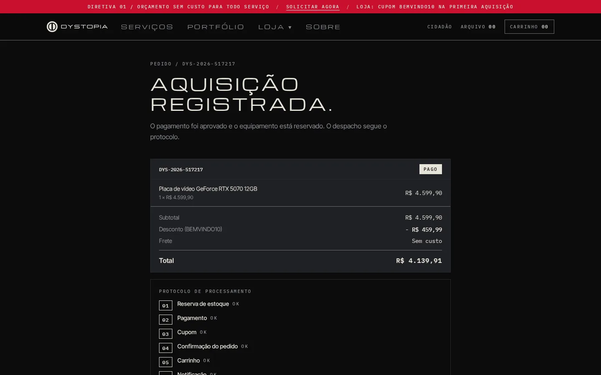 | 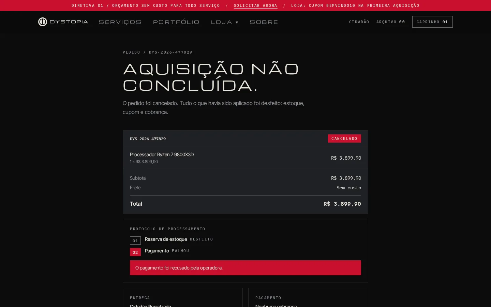 |

| Painel de orquestração (`/admin/orquestracao`) |
|---|
| 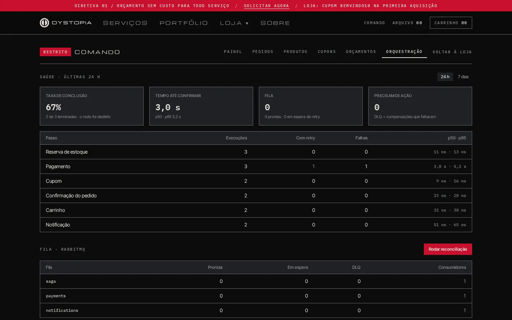 |

| Assistente com IA consultando o catálogo | E-mail de confirmação |
|---|---|
| 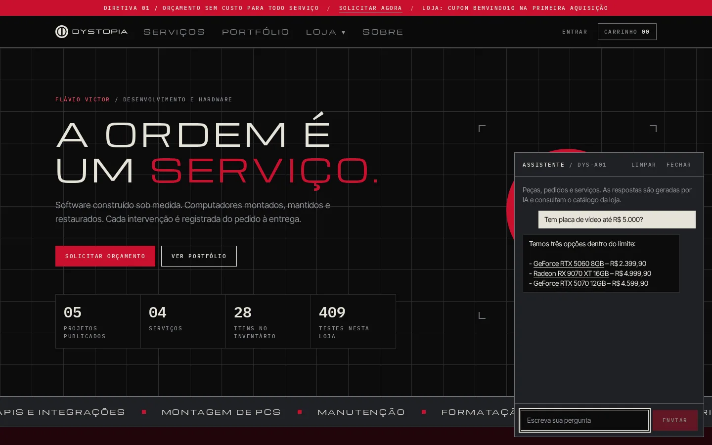 | 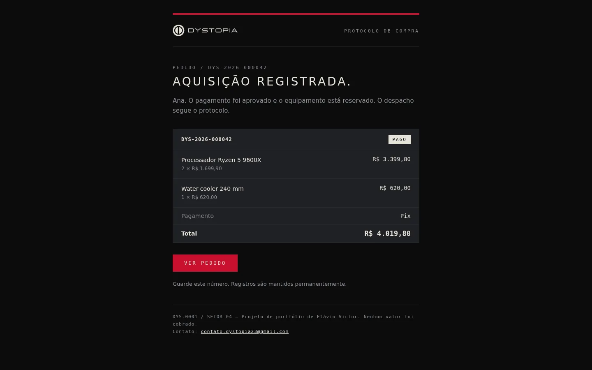 |

| Serviços e orçamento | Portfólio |
|---|---|
| 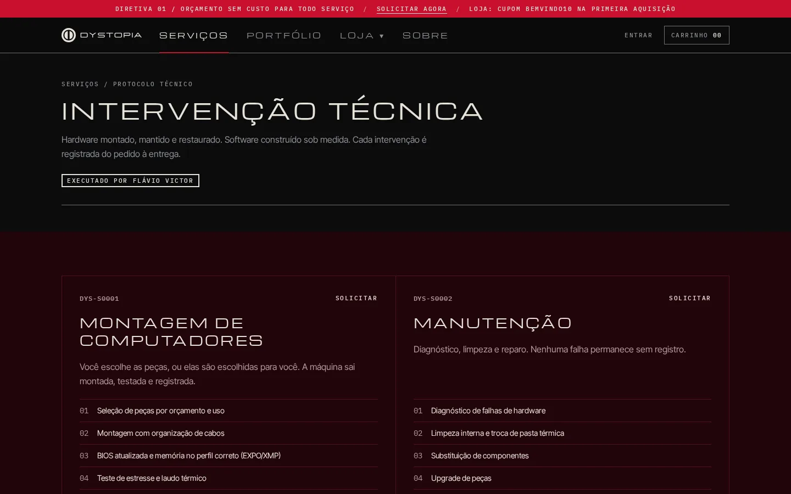 | 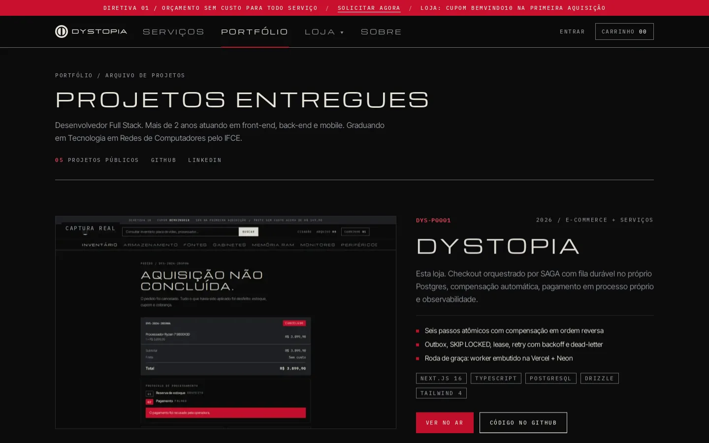 |

| Produto com foto real e ficha técnica | Checkout com cupom |
|---|---|
| 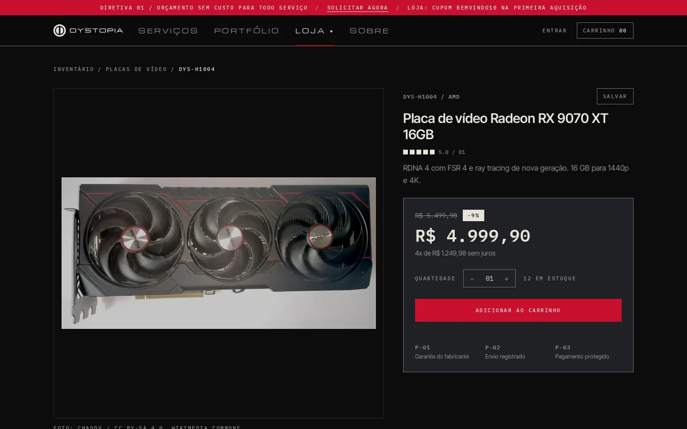 | 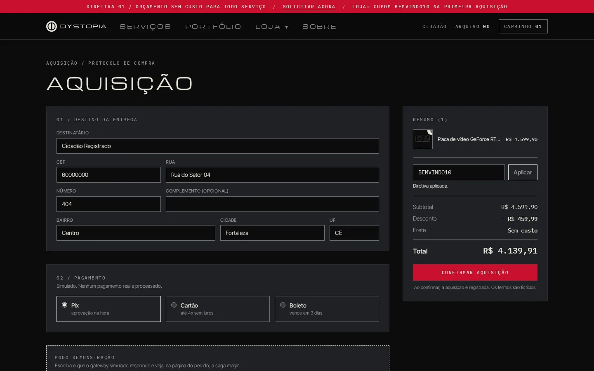 |

| Painel admin | Celular |
|---|---|
| 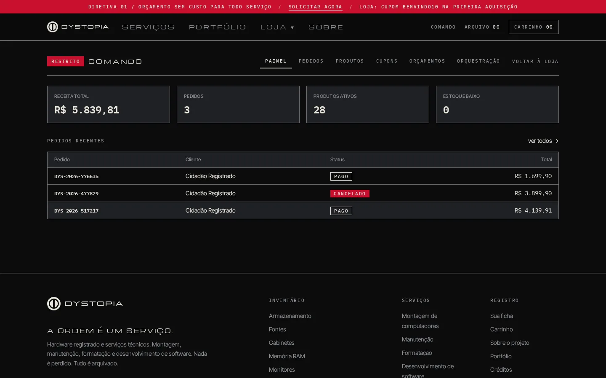 | 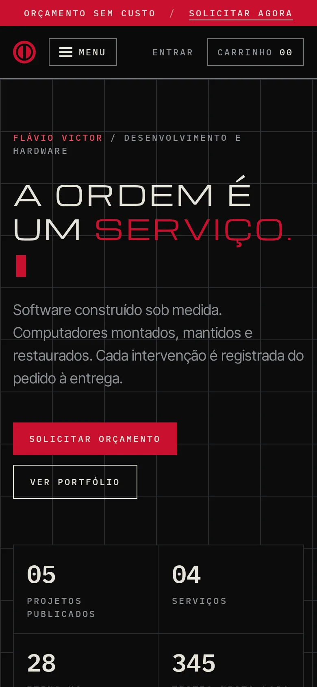 |

Os prints são gerados contra um banco populado só pelo seed, com pedidos feitos
pelo próprio fluxo da loja num navegador de verdade (Playwright) — o recusado
usa o gateway simulado (`ALLOW_CHECKOUT_SIMULATION`). O do assistente é uma
conversa real com o modelo, no site publicado.

## Arquitetura

```
app/ + components/     UI e rotas (Server Components)
lib/actions            borda HTTP (Server Actions): valida (Zod) e chama o caso de uso
application/           casos de uso: checkout, orçamento, LGPD, ligar o MFA
saga/                  orquestração: ordem dos passos, retry, compensação
services/*             regra de negócio, uma responsabilidade por serviço
queue/                 outbox, relay, RabbitMQ, política de retry, DLQ
db/                    schema Drizzle + migrations
```

A dependência só aponta para baixo (borda → aplicação → saga → serviços →
banco), e isso é verificado por teste. O caminho de um pedido:

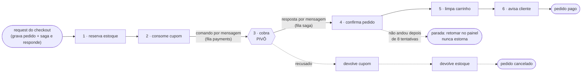

*As setas indicam ordem, não chamada síncrona: entre um passo e outro há uma
mensagem durável. Nada é "fire and forget" — quando o request responde, pedido
e mensagem já estão commitados juntos. A cobrança é o **pivô**: tudo que pode
falhar por regra (estoque, cupom) vem antes dela, e depois dela a saga só anda
para a frente.*

Detalhes em [`docs/SAGA-E-FILA.md`](docs/SAGA-E-FILA.md) (saga, fila,
pagamentos, garantias, observabilidade) e
[`docs/ARQUITETURA.md`](docs/ARQUITETURA.md) (invariantes e como estender).

## Stack

Next.js 16 (App Router, Server Actions) · TypeScript · PostgreSQL + Drizzle ·
RabbitMQ (`amqplib`) · Zod · Tailwind CSS v4 · `node:test` + Playwright.

Orquestrador, relay da outbox, política de retry e logger são do projeto — é
onde está o interesse do portfólio. O Stripe é chamado por `fetch`, sem SDK.

## Rodando

A stack inteira (banco, broker, migrations, app, worker e pagamentos):

```bash
docker compose --profile app up -d --build
docker compose --profile app run --rm migrate npm run db:seed
# loja em http://localhost:3000 · painel do RabbitMQ em http://localhost:15672
```

Para desenvolver, só a infraestrutura sobe em container:

```bash
cp .env.example .env              # MFA_ENCRYPTION_KEY: openssl rand -base64 32
npm install
docker compose up -d              # Postgres (5544) + RabbitMQ (5672)
PAYMENTS_DATABASE_CREATE=1 npm run db:migrate && npm run db:seed   # loja + banco de pagamentos
npm run dev                       # app em http://localhost:3000
npm run worker                    # outro terminal: filas saga e notifications
npm run worker:payments           # outro terminal: processo de pagamentos
```

Contas do seed local: `admin@dystopia.dev` / `admin123` e
`cliente@dystopia.dev` / `cliente123`. No primeiro login o admin cadastra um
app autenticador (QR em `/conta/seguranca`); o painel não abre sem ele. Contra banco remoto o seed se recusa a
rodar sem confirmação explícita e senha de admin forte.

## Testes

```bash
npm test             # unitários + integração (Postgres e RabbitMQ reais)
npm run test:unit    # só o que não precisa de banco
npm run test:e2e     # navegador, contra a loja rodando (ver playwright.config.ts)
```

O runner cria e migra um banco próprio (`dystopia_test`) e isola as filas num
prefixo próprio, com filas de espera de milissegundos — o retry passa de
verdade pelo broker. Os testes verificam efeito, não chamada: depois de um
caminho triste, a asserção é "o estoque voltou, a cobrança foi estornada, o
pedido está cancelado".

O CI (`.github/workflows/ci.yml`) roda tipos, lint, migrations em banco limpo,
testes e build, e depois os testes de navegador contra a stack do compose.

## Decisões técnicas

**SAGA em vez de uma transação só.** A transação cobre só o banco; pagamento,
e-mail e integrações não fazem `ROLLBACK`. Cada passo é atômico e tem
compensação explícita — em vez de pedido pago sem estoque ou estoque baixado
sem cobrança.

**RabbitMQ com outbox.** A saga precisa de fila de trabalho: `ack` por
mensagem, reentrega quando o consumidor morre, atraso para retry e DLQ — o
modelo nativo do RabbitMQ. Kafka é um log (ótimo para stream com replay), sem
`ack` por mensagem nem atraso nativo. E publicar a partir de uma transação
exige outbox com qualquer broker; sem ela é *dual write*.

**Drizzle.** SQL explícito e tipado a partir do schema, sem engine binária, e
migrations geradas em SQL que dá para revisar — o que importa num projeto que
depende de `FOR UPDATE SKIP LOCKED`, índice parcial, `NULLS NOT DISTINCT` e
índice GIN sobre expressão.

**Serviços no mesmo deploy.** O custo de operar cada serviço separado não se
paga aqui; o de não ter fronteira, sim. As fronteiras são reais (sem import
cruzado, verificado por teste) e pagamentos já é separado de verdade: processo,
banco e outbox próprios, e a loja só sabe dele o que chega por mensagem.

## Segurança

O que protege a loja exposta na internet, e onde cada coisa mora:

| Ameaça | Defesa |
|---|---|
| Força bruta de senha | Limite por IP no login (10 / 15 min) e no cadastro (5 / h), contado no Postgres com UPSERT atômico (`services/rate-limit`) — em serverless um contador em memória seria dividido entre instâncias. O IP só vem de header escrito pela borda da Vercel ou pelo proxy do compose (`TRUST_PROXY_HEADERS`): o cliente não forja um contador novo |
| Descobrir quais e-mails têm conta | Login responde a mesma mensagem e no mesmo tempo: e-mail inexistente compara contra um hash bcrypt real |
| CSRF | Server Actions só aceitam POST e o Next compara `Origin` com `Host`; cookie `SameSite=lax` |
| Sessão roubada ou esquecida aberta | Sessão é linha no banco (`services/sessions`): o cookie `httpOnly`/`secure` leva 32 bytes aleatórios e o banco guarda só o SHA-256 deles. Sair apaga a linha — o cookie copiado morre na hora; "sair dos outros aparelhos" em `/conta/seguranca`. Validade de 7 dias, sem renovação |
| Senha do admin vazada | **MFA obrigatório no painel** (`services/mfa`): TOTP (RFC 6238, testado com os vetores do RFC), segredo cifrado no banco (AES-256-GCM, ligado ao id da conta), código que não vale duas vezes nem em dois logins simultâneos (UPDATE condicional), 10 códigos de recuperação de uso único, limite de 5 tentativas / 15 min e 20 / dia por conta |
| Admin rebaixado mantendo acesso | Papel e MFA são relidos do banco a cada request (uma query: sessão + usuário + MFA) |
| Injeção de SQL ou `DATABASE_URL` vazada | O app conecta como `dystopia_app` (`src/db/app-role.ts`): só SELECT/INSERT/UPDATE/DELETE. Não apaga, cria nem esvazia tabela (provado em `tests/integration/db-app-role.test.ts`); migrations rodam com outra conexão, a do dono |
| Ver/alterar dado alheio | Toda action de endereço, carrinho, pedido e avaliação filtra pelo dono; action de admin chama `ensureAdmin()` |
| Clickjacking e afins | `frame-ancestors 'none'`, `X-Frame-Options`, `nosniff`, HSTS, `Referrer-Policy` (`next.config.ts`) |
| Senha de demo em produção | O seed recusa banco remoto sem `SEED_ALLOW_REMOTE=1` e uma `SEED_ADMIN_PASSWORD` forte |

O limite é por IP e não por e-mail de propósito: por e-mail, qualquer um
trancaria a conta demo (cujo e-mail é público) errando a senha. O cadastro
ainda diz "já existe uma conta com esse e-mail" — é a troca usual por uma
mensagem útil, e o limite de 5 por hora torna a varredura impraticável.

## Documentação

- [`docs/SAGA-E-FILA.md`](docs/SAGA-E-FILA.md) — checkout, fila, pagamentos, garantias e observabilidade
- [`docs/ARQUITETURA.md`](docs/ARQUITETURA.md) — camadas, invariantes, convenções e como estender
- [`docs/DECISOES.md`](docs/DECISOES.md) — por que cada escolha (saga, RabbitMQ, outbox, sessão no banco, MFA...), o que ficou de fora e o preço pago
- [`docs/DEPLOY.md`](docs/DEPLOY.md) — Vercel + Neon + CloudAMQP, custo zero
- [`docs/AWS.md`](docs/AWS.md) — 2º ambiente na AWS em Pulumi (ECS Fargate, CloudFront, OIDC), custo zero com créditos, sobe e desce pelo Actions
- [`docs/RECUPERACAO.md`](docs/RECUPERACAO.md) — o que fazer quando dá errado: deploy, dado apagado, fila, segredo vazado, admin sem celular
- [`docs/FUNCIONALIDADES.md`](docs/FUNCIONALIDADES.md) — identidade visual, conta, painel admin e modelagem do banco
