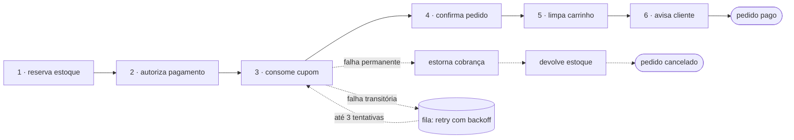

# Dystopia 🛒⚡

E-commerce geek fictício, construído como projeto de portfólio. Visual vibrante
de marketplace, com cara de loja geek brasileira — e, por baixo, um checkout
orquestrado por **SAGA** com fila durável, compensação e reconciliação.


## Em 30 segundos

- **Checkout que não deixa pedido pela metade.** Seis passos atômicos (estoque,
  pagamento, cupom, confirmação, carrinho, aviso), cada um num serviço. Se um
  falha de vez, os anteriores são desfeitos em ordem reversa.
- **Fila durável no próprio Postgres**, sem broker: outbox, `SKIP LOCKED`,
  lease, retry com backoff, dead-letter e reconciliação automática.
- **Testado contra banco real**: compensação, retry, crash no meio do passo e
  concorrência — e um teste de arquitetura que impede serviço de importar
  serviço.
- **Pronto pra ficar exposto**: limite de tentativas contado no banco, login
  que não revela quais e-mails existem, CSRF e headers de segurança
  ([detalhes](#segurança)).
- Loja completa em volta: catálogo com busca e filtros, carrinho persistente,
  cupons, avaliações com compra verificada, favoritos, endereços e painel admin.

## Telas

| Pedido confirmado: a saga passo a passo | Pagamento recusado: tudo desfeito |
|---|---|
|  |  |

| Painel de orquestração (`/admin/orquestracao`) | Checkout com cupom |
|---|---|
|  |  |

| Produto | Painel admin | Celular |
|---|---|---|
|  |  |  |

Os prints são gerados contra um banco populado só pelo seed, com pedidos feitos
pelo próprio fluxo da loja — o recusado usa o gateway simulado
(`ALLOW_CHECKOUT_SIMULATION`).

## Stack

- **Framework**: Next.js 16 (App Router, Server Actions, TypeScript)
- **Estilo**: Tailwind CSS v4
- **Banco de dados**: PostgreSQL
- **ORM**: [Drizzle ORM](https://orm.drizzle.team/) + `drizzle-kit` (migrations)
- **Orquestração**: SAGA + fila, implementadas no projeto (sem broker externo)
- **Testes**: `node:test` + `tsx` (187 testes, unitários e de integração)

Dependências de runtime: `next`, `react`, `drizzle-orm`, `pg`, `jose`,
`bcryptjs`, `dotenv`. Nada além disso — fila, orquestrador, logger e runner de
teste são do projeto, de propósito (ver [Decisões](#decisões-técnicas)).

## Arquitetura

### Camadas

```
src/app, src/components     UI e rotas (Server Components)
src/lib/actions             borda HTTP (Server Actions): valida entrada, nada de regra
src/saga                    orquestração: ordem, retry, compensação, reconciliação
src/services/*              regra de negócio — uma responsabilidade por serviço
src/queue                   fila genérica: claim, backoff, dead-letter
src/db                      schema Drizzle + pool
```

A dependência só aponta pra baixo (**borda → saga → serviços → db**) e isso é
testado: `tests/unit/architecture.test.ts` falha se um serviço importar outro
serviço, importar `next/*` ou conhecer a borda HTTP. É o que mantém cada
serviço pronto pra ser extraído num processo separado sem reescrever regra.

### O checkout como SAGA

Antes, `placeOrder` fazia tudo numa transação só: pedido, pagamento, cupom,
estoque, carrinho. Funciona — até o "pagamento" deixar de ser um `insert` e
virar uma chamada HTTP pra um provedor, que não participa do `COMMIT`.

Hoje o fluxo é:

```
placeOrder (Server Action)
  └─ 1 transação: endereço + pedido(pending) + itens + saga + job   ← outbox
         │
         ├─ caminho rápido: o próprio request avança a saga
         │                  (cliente já cai na página do pedido pronto)
         └─ caminho durável: o worker pega o job da fila
                            (se o processo do Next morrer, ele termina)

            o lease da saga garante que só um dos dois avança por vez
```

| # | Passo | Serviço | Compensação |
|---|---|---|---|
| 1 | `reserve-stock` | `services/inventory` | devolve as unidades |
| 2 | `authorize-payment` | `services/payments` | estorna a cobrança |
| 3 | `consume-coupon` | `services/coupons` | devolve o uso do cupom |
| 4 | `confirm-order` | `services/orders` | cancela o pedido |
| 5 | `clear-cart` | `services/carts` | restaura os itens do carrinho |
| 6 | `notify-customer` | `services/notifications` | — (só avisa) |



*Exemplo com falha no passo 3: só o que já foi aplicado (2 e 1) é desfeito, do
mais recente pro mais antigo. Qualquer passo segue o mesmo padrão.*

- **Falha de negócio** (sem estoque, pagamento recusado, cupom esgotado) →
  compensa na hora, em ordem reversa, e o pedido vira `cancelled`.
- **Falha transitória** (provedor fora, deadlock) → volta pra fila com backoff
  exponencial, até 3 tentativas por passo; depois compensa.
- O cliente vê isso em `/pedido/[orderNumber]`: pedido "em processamento" com a
  linha do tempo dos passos (a página se atualiza sozinha), confirmado, ou
  cancelado com o motivo.

### Garantias (e como cada uma é obtida)

| Garantia | Mecanismo |
|---|---|
| Nenhum pedido sem orquestração | **Outbox**: pedido + saga + job na mesma transação |
| Passo nunca aplica pela metade | Passo e seu log (`saga_steps`) commitam juntos |
| Passo nunca aplica duas vezes | Log `completed` é registro de idempotência; efeito externo usa chave (`payments.idempotency_key`) |
| Nenhum job processado em paralelo | `claim` com `FOR UPDATE SKIP LOCKED` |
| Nenhum job duplicado | Índice único **parcial** em `dedupe_key` para status ativos |
| Worker morto não trava nada | *Lease* com prazo em saga e job + reconciliação |
| Nada fica parado pra sempre | Reconciliação reenfileira saga em andamento sem job |
| Sem venda sem estoque | `UPDATE ... WHERE stock_quantity >= quantidade` (0 linhas = erro permanente) |
| Erro repetido não gira pra sempre | Tentativa contada antes de executar + dead-letter |

Estado durável: `sagas` (instância), `saga_steps` (log por passo), `jobs`
(fila). Tudo visível em **`/admin/orquestracao`**, com botão de reconciliação
manual e reprocessamento da dead-letter.

### Fluxo de sincronização

O worker roda a reconciliação a cada 30s (ou `npm run reconcile` na mão):

1. lease de saga vencido → libera, outro executor assume;
2. job `running` com lease vencido → volta pra fila;
3. saga em andamento **sem job ativo** → enfileira de novo.

O item 3 é a garantia de progresso: por pior que seja o momento do crash,
sempre volta a existir um job pra terminar a saga.

## Conta do cliente

| Rota | O que faz |
|---|---|
| `/conta` | Dados da conta e histórico de pedidos (com o status real de cada um) |
| `/conta/enderecos` | Agenda de endereços: cadastrar, definir padrão, remover |
| `/favoritos` | Lista de desejos (coração na vitrine e na página do produto) |

- **Avaliações**: quem está logado avalia direto na página do produto (1 a 5
  estrelas, título e comentário opcionais). Uma avaliação por pessoa por
  produto — reenviar edita a sua. Quem já comprou o item ganha o selo *compra
  verificada* (checado contra pedidos pagos), e a média/contagem do produto são
  recalculadas na mesma transação da escrita.
- **Endereços**: o endereço digitado no checkout entra na agenda, e os salvos
  aparecem como opção no próximo pedido. Endereço usado em pedido não pode ser
  removido (a FK é `RESTRICT` de propósito) — a interface explica em vez de
  estourar erro.
- **Favoritos**: o coração aparece em toda a vitrine com **uma** query por
  request (React `cache()` + um componente de servidor que resolve o estado),
  não uma por card.

## Modelagem do banco

18 tabelas: 14 do domínio de e-commerce + 4 da orquestração.

| Domínio | Tabelas |
|---|---|
| Usuários | `users`, `addresses` |
| Catálogo | `categories`, `products`, `product_images`, `product_variants` |
| Carrinho | `carts`, `cart_items` |
| Pedidos | `orders`, `order_items`, `payments`, `coupons` |
| Social | `reviews`, `wishlist_items` |
| Orquestração | `sagas`, `saga_steps`, `jobs`, `notifications` |

Decisões de design:

- **Preços em centavos** (`integer`) em vez de float, pra evitar erro de arredondamento.
- **Snapshots de preço** em `cart_items` e `order_items` — o preço do produto pode mudar depois da compra, então guardamos o valor no momento da operação.
- **Variantes flexíveis** (`product_variants.attributes` é `jsonb`) — um produto pode ter tamanho, cor, ou nenhuma variação, sem precisar de colunas fixas pra cada atributo possível.
- **Categorias hierárquicas** (`categories.parent_id` auto-referenciado) — dá pra ter subcategorias no futuro sem migrar o schema de novo.
- **Carrinho de visitante** (`carts.session_token` nullable junto de `user_id` nullable) — permite carrinho antes do login.
- **Status de pedido é máquina de estados** (`src/lib/order-status.ts`): "entregue → pendente" não existe, nem no admin nem na saga.
- **Chave de idempotência no pagamento** (`payments.idempotency_key`, unique) — reexecutar o passo não cria segunda cobrança.
- Ver o schema completo comentado em [`src/db/schema.ts`](./src/db/schema.ts).

## Rodando localmente

```bash
cp .env.example .env          # ajuste SESSION_SECRET (openssl rand -base64 32)
npm install
docker compose up -d          # Postgres 16 na porta 5544
npm run db:migrate            # cria o schema
npm run db:seed               # 20 produtos, categorias, usuários e cupom
npm run dev                   # loja em http://localhost:3000
npm run worker                # em outro terminal: processa a fila/sagas
```

O `docker-compose.yml` sobe só o banco (porta **5544** por padrão, pra não
brigar com um Postgres que já exista na 5432; `POSTGRES_PORT=5600 docker
compose up -d` muda isso). `docker compose down` para o banco preservando os
dados; `down -v` apaga o volume.

Sem Docker, basta apontar o `DATABASE_URL` pra qualquer Postgres 15+ e rodar
os mesmos `db:migrate` / `db:seed`.

> Sem o worker a loja funciona: o checkout avança a saga no próprio request.
> O worker é quem cuida de retry, reconciliação e dos pedidos que ficaram no
> meio do caminho — em produção ele é obrigatório, como processo separado do
> servidor web.

### Credenciais de teste (após o seed)

| Papel | Email | Senha |
|---|---|---|
| Admin | `admin@dystopia.dev` | `admin123` |
| Cliente | `cliente@dystopia.dev` | `cliente123` |

Essas senhas valem **só no banco local**. Contra um banco remoto o seed se
recusa a rodar sem `SEED_ALLOW_REMOTE=1` e sem uma `SEED_ADMIN_PASSWORD` de
pelo menos 16 caracteres — a senha de admin acima é pública, então nunca chega
a produção.

### Scripts úteis

| Comando | O que faz |
|---|---|
| `npm run dev` | Servidor de desenvolvimento |
| `npm run worker` | Worker da fila (sagas, retry, reconciliação) |
| `npm run reconcile` | Roda a reconciliação uma vez e imprime o relatório |
| `npm test` | Suíte completa (cria e migra o banco de teste sozinho) |
| `npm run test:unit` | Só os testes que não precisam de banco |
| `npm run lint` | ESLint |
| `npm run db:generate` | Gera migration a partir de `src/db/schema.ts` |
| `npm run db:migrate` | Aplica migrations pendentes |
| `npm run db:studio` | Abre o Drizzle Studio (GUI do banco) |
| `npm run db:seed` | Popula o banco com dados de exemplo |

## Deploy

Dois processos, dois lugares — porque têm formatos diferentes:

| Peça | Onde | Por quê |
|---|---|---|
| App web (Next.js) | **Vercel** | serverless; o checkout avança a saga no próprio request |
| Worker da fila | **Railway** (container, `Dockerfile.worker`) | precisa ficar vivo fazendo polling — serverless não serve |
| Postgres | **Railway** | mesmo projeto do worker (rede privada entre os dois) |

As migrations rodam no `preDeployCommand` do worker (`railway.json`), então
todo deploy do worker aplica as pendentes antes de subir o código novo.

### 1. Railway — banco + worker

1. Novo projeto → **Deploy from GitHub repo** → este repositório. O
   `railway.json` já aponta pro `Dockerfile.worker`.
2. No mesmo projeto, **+ New → Database → PostgreSQL**. Região: **US East**.
3. Variável do serviço do worker: `DATABASE_URL` = `${{Postgres.DATABASE_URL}}`
   (URL interna). Ele não precisa de `SESSION_SECRET` — não lida com sessão.
4. Em **Settings → Networking** do Postgres, habilite o **TCP Proxy** e copie
   a `DATABASE_PUBLIC_URL` — é por ela que a Vercel e o seed chegam no banco.
5. Popule uma vez, da sua máquina (a senha de admin fica só com você):

   ```bash
   DATABASE_URL='<DATABASE_PUBLIC_URL>' SEED_ALLOW_REMOTE=1 \
     SEED_ADMIN_PASSWORD="$(openssl rand -base64 24)" npm run db:seed
   ```

   Guarde a senha gerada num gerenciador antes — o seed não a imprime.

### 2. Vercel — app

1. **Add New → Project** → este repositório (framework detectado: Next.js).
2. Variáveis de ambiente (Production):
   - `DATABASE_URL` = a `DATABASE_PUBLIC_URL` da Railway
   - `SESSION_SECRET` = `openssl rand -base64 32` (novo, nunca o do `.env` local)
   - `PG_POOL_MAX` = `3` (cada instância da função tem o próprio pool)
3. Deploy. O `vercel.json` fixa as funções em `iad1`, perto do US East da
   Railway — cada página faz várias queries, e a distância até o banco pesa
   mais que a distância até o visitante.

**Não** defina `ALLOW_CHECKOUT_SIMULATION` em produção, e nunca reaproveite
`.env` local nem a senha `dystopia_dev_pw` do compose.

## Testes

```bash
npm test          # 187 testes
npm run test:unit # subconjunto sem banco
```

`node:test` + `tsx`, sem framework extra. O runner (`tests/run.ts`) deriva o
banco de teste do `DATABASE_URL` (`dystopia` → `dystopia_test`), cria e migra
antes de rodar, e executa os arquivos em série.

- **`tests/unit/`** — regra de cupom, backoff, validação de produto, máquina de
  estados, payload da saga, taxonomia de erro e **fronteiras de arquitetura**.
- **`tests/integration/`** — Postgres real: caminho feliz do checkout,
  compensação (sem estoque, pagamento recusado, cupom esgotado), retry
  transitório terminado **pelo worker**, idempotência (reexecução e retomada
  pós-crash não duplicam efeito), concorrência da fila (`SKIP LOCKED`),
  dead-letter, reconciliação, avaliações, favoritos, agenda de endereços,
  catálogo (slug/SKU único, variantes) e administração de cupons.

Os testes verificam **efeito**, não chamada: depois de um caminho triste, a
asserção é "o estoque voltou, a cobrança foi estornada, o pedido está
cancelado, o carrinho continua lá".

Para ver um caminho triste na mão, suba o app com
`ALLOW_CHECKOUT_SIMULATION=1` e envie `simulate=decline` (ou `flaky_once`,
`unavailable`) no checkout.

### CI

`.github/workflows/ci.yml` roda a cada push/PR, com um Postgres de verdade
como *service container*: tipos → lint → **migrations num banco limpo** →
testes → build de produção. É a mesma sequência que vale localmente:

```bash
npx tsc --noEmit && npm run lint && npm test && npm run build
```

## Segurança

O que protege a loja exposta na internet, e onde cada coisa mora:

| Ameaça | Defesa |
|---|---|
| Força bruta de senha | Limite por IP no login (10 / 15 min) e no cadastro (5 / h), contado no Postgres com UPSERT atômico (`services/rate-limit`) — em serverless um contador em memória seria dividido entre instâncias |
| Descobrir quais e-mails têm conta | Login responde a mesma mensagem e no mesmo tempo: e-mail inexistente compara contra um hash bcrypt real |
| CSRF | Server Actions só aceitam POST e o Next compara `Origin` com `Host`; cookie `SameSite=lax` |
| Sessão forjada | JWT HS256 em cookie `httpOnly`/`secure`; sem `SESSION_SECRET` o app não sobe |
| Admin rebaixado mantendo acesso | O papel é relido do banco a cada request, não confiado no JWT |
| Ver/alterar dado alheio | Toda action de endereço, carrinho, pedido e avaliação filtra pelo dono; action de admin chama `ensureAdmin()` |
| Clickjacking e afins | `frame-ancestors 'none'`, `X-Frame-Options`, `nosniff`, HSTS, `Referrer-Policy` (`next.config.ts`) |
| Senha de demo em produção | O seed recusa banco remoto sem `SEED_ALLOW_REMOTE=1` e uma `SEED_ADMIN_PASSWORD` forte |

O limite é por IP e não por e-mail de propósito: por e-mail, qualquer um
trancaria a conta demo (cujo e-mail é público) errando a senha. O cadastro
ainda diz "já existe uma conta com esse e-mail" — é a troca usual por uma
mensagem útil, e o limite de 5 por hora torna a varredura impraticável.

## Painel admin

Entre com o usuário admin do seed e acesse [`/admin`](http://localhost:3000/admin)
(o link também aparece em `/conta`). Visitante ou cliente que tentar entrar é
redirecionado pra `/entrar`, e as Server Actions do painel checam `role` antes
de escrever.

| Rota | O que faz |
|---|---|
| `/admin` | Receita, nº de pedidos, produtos ativos, estoque baixo + últimos pedidos |
| `/admin/pedidos` | Todos os pedidos (cliente, data, itens, status, total) |
| `/admin/pedidos/[orderNumber]` | Itens, totais, endereço, pagamento, troca de status e a saga do pedido |
| `/admin/produtos` | Lista com preço/estoque e toggles de "ativo" e "destaque" |
| `/admin/produtos/novo` · `/admin/produtos/[id]` | Criar e editar produto, com variantes (tamanho/cor, SKU, preço e estoque próprios) |
| `/admin/cupons` · `/admin/cupons/novo` · `/admin/cupons/[id]` | Cupons: percentual ou valor fixo, pedido mínimo, limite de usos e validade |
| `/admin/orquestracao` | Sagas, fila, dead-letter, notificações e reconciliação |

## Decisões técnicas

### Por que Drizzle em vez de Prisma?

A ideia inicial era Prisma, mas o ambiente de build usado neste projeto bloqueia
o download dos binários de engine do Prisma (`binaries.prisma.sh`). Drizzle é
TypeScript puro — sem engine nativo — e resolve isso sem abrir mão de
migrations tipadas e um query builder relacional forte. Em produção (Vercel,
por exemplo) isso não seria um problema, mas Drizzle é uma escolha sólida de
qualquer forma: mais leve, SQL-first, ótimo DX.

### Por que SAGA, se dá pra fazer tudo numa transação?

Porque a transação só cobre o que está no banco. Confirmação de pagamento,
e-mail e integração com ERP/antifraude não fazem `ROLLBACK`. A saga troca
"atomicidade" por "compensação": cada passo é atômico e reversível, e o
fracasso tem um caminho de volta explícito e auditável — em vez de um pedido
pago sem estoque, ou estoque baixado sem cobrança.

### Por que fila no Postgres em vez de Kafka/RabbitMQ?

O produtor da mensagem é sempre uma transação de negócio. Gravando o job na
mesma transação (**outbox**), a entrega é garantida sem commit distribuído.
Com broker externo, seria necessário outbox + relay de qualquer forma — ou seja,
o Postgres entraria no caminho mesmo assim, só com uma peça de infra a mais pra
operar. Em escala de portfólio (e de muitas lojas reais), `FOR UPDATE SKIP
LOCKED` resolve: é a mesma técnica usada por filas como `pgmq` e `Que`.

Quando valeria trocar: múltiplos consumidores independentes do mesmo evento,
fan-out alto, retenção/replay de eventos, ou throughput que o Postgres não
sustente. O desenho atual não impede a troca — `src/queue` é a única peça que
muda; serviços e saga não sabem onde a mensagem trafega.

### Por que "serviços" se tudo roda num deploy só?

Porque o custo de operar 5 processos + broker não se paga neste projeto, mas o
custo de **não ter fronteira** se paga rápido: é o que transforma um checkout em
bola de barro. Então as fronteiras são reais (responsabilidade única, contrato
explícito via `Executor`, proibição de import cruzado verificada por teste) e a
separação física fica como passo seguinte, não como pré-requisito.

Pra extrair um serviço: ele já não importa `next/*` nem outro serviço, então
vira um processo que consome a mesma fila (ou expõe HTTP) e a saga passa a
chamá-lo por rede, trocando só o `invoke`/`compensate` do passo.

## Próximos passos

- [x] Layout base (header, footer, identidade visual)
- [x] Catálogo, busca e página de produto
- [x] Carrinho persistente (`carts`/`cart_items`)
- [x] Autenticação (login/cadastro)
- [x] Checkout + criação de pedido
- [x] Painel admin (produtos/pedidos)
- [x] SAGA + fila + compensação + reconciliação
- [ ] Gateway de pagamento real no lugar do provedor simulado
- [ ] Notificação de verdade (e-mail/webhook) no passo `notify-customer`
- [x] Avaliações e lista de desejos na interface
- [x] Agenda de endereços reaproveitada no checkout
- [x] Admin de cupons e de variantes
- [ ] Observabilidade: métricas de fila/saga e alerta de dead-letter
- [ ] Extrair `payments` pra um serviço próprio consumindo a fila
