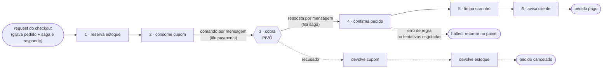

# Checkout: saga, fila e pagamentos

Como um pedido vira pago (ou desfeito) sem nunca ficar pela metade. Guia de
engenharia (camadas, invariantes, como estender): [`ARQUITETURA.md`](ARQUITETURA.md).

## O checkout como SAGA

Antes, `placeOrder` fazia tudo numa transação só: pedido, pagamento, cupom,
estoque, carrinho. Funciona — até o "pagamento" deixar de ser um `insert` e
virar uma chamada HTTP para um provedor, que não participa do `COMMIT`.

Hoje o fluxo é:

```
placeOrder (Server Action) → placeOrder (caso de uso, src/application/checkout.ts)
  └─ 1 transação: endereço + pedido(pending) + itens + saga + mensagem na outbox
         │  e responde — a página do pedido mostra "processando" e se
         │  atualiza sozinha
         │
         └─ relay ──▶ RabbitMQ ──▶ consumidor da fila `saga`
            (`npm run worker` em container; no deploy só-Vercel, o dreno
             depois da resposta — o mesmo código de consumo)

            o lease da saga garante que só um consumidor avança por vez
```

Nada aqui é *fire and forget*: quando o request responde, o pedido e a
mensagem já estão commitados juntos. A partir daí tudo é **assíncrono e
durável** — os passos rodam em ordem, um de cada vez, mas fora do request.

| # | Passo | Serviço | Papel | Se falhar |
|---|---|---|---|---|
| 1 | `reserve-stock` | `services/inventory` | compensável | desfaz (devolve as unidades) |
| 2 | `consume-coupon` | `services/coupons` | compensável | desfaz (devolve o uso do cupom) |
| 3 | `authorize-payment` | `services/payments` — **processo próprio**, por mensagem | **pivô** | recusado: desfaz 2 e 1 |
| 4 | `confirm-order` | `services/orders` | retentável | tenta de novo; não andou, para em `halted` |
| 5 | `clear-cart` | `services/carts` | retentável | idem |
| 6 | `notify-customer` | `services/notifications` | retentável | idem |



### Por que essa ordem: compensável → pivô → retentável

É o desenho clássico de saga (Garcia-Molina & Salem; Chris Richardson,
*Microservices Patterns*). Cada passo tem um papel:

- **Compensável** (estoque, cupom): tem como desfazer, e desfazer é barato e
  interno. Vem primeiro tudo o que pode falhar por regra (sem estoque, cupom
  esgotado) — quando falha, nada foi cobrado.
- **Pivô** (cobrança): o ponto sem volta. Estornar custa taxa, demora e aparece
  na fatura do cliente, então a cobrança só acontece quando o resto já está
  garantido. Recusada, a saga desfaz os compensáveis; aprovada, a saga **tem**
  que terminar.
- **Retentável** (confirmar, limpar carrinho, avisar): vem depois do pivô e não
  desiste. Falha passageira tenta de novo (até 8 vezes, ~2 min de backoff);
  erro de regra ou tentativas esgotadas param a saga em `halted`, com alerta
  crítico no painel e botão **Retomar** — depois de alguém corrigir a causa.
  **Pedido pago nunca é estornado por um erro de confirmação.**

`validateSagaDefinition` (registry) recusa uma definição fora dessa ordem, com
dois pivôs ou com compensação depois do ponto sem volta.

### Versão da definição

Cada saga grava `definition_version` ao nascer e termina naquela versão. Mudar
a ordem dos passos com saga em andamento faria `current_step` apontar para o
passo errado — por isso a ordem nova é a **v2** e a antiga (cobrança antes do
cupom, tudo compensável) segue registrada como **v1** em
`definitions/checkout.v1.ts` até não haver mais saga dela rodando.

- **Falha de negócio** antes do pivô ou no pivô (sem estoque, cupom esgotado,
  pagamento recusado) → compensa na hora, em ordem reversa, e o pedido vira
  `cancelled`.
- **Falha transitória** (provedor fora, deadlock) → retry com backoff
  exponencial (3 tentativas nos compensáveis, 8 nos retentáveis). Durante o
  backoff a saga fica "ocupada" até a hora do retry, então mensagem duplicada
  não adianta a tentativa.
- O cliente vê isso em `/pedido/[orderNumber]`: pedido "em processamento" com a
  linha do tempo dos passos (a página se atualiza sozinha), confirmado, ou
  cancelado com o motivo.

## Pagamentos em processo próprio

O pagamento é o único passo que fala com o "mundo de fora" (o gateway), então
é o que foi extraído: roda em outro processo (`npm run worker:payments`),
consumindo a fila `payments` do RabbitMQ, e a saga fala com ele **só por
mensagem**.

```
saga ── payments.authorize ──▶ outbox ─relay─▶ fila payments ──▶ processo de pagamentos
saga ◀──── saga.reply ──────── fila saga ◀─relay─ outbox ◀── cobrança + resposta (1 transação)
```

- **Contrato** (`services/payments/contract.ts`): nomes dos comandos e formato
  das mensagens. É tudo que o resto do sistema pode importar de pagamentos — o
  teste de arquitetura falha se alguém importar a implementação.
- **Endereço de resposta** (`queue/reply.ts`): o comando leva um `replyTo` e
  pagamentos responde nele sem saber que existe uma saga.
- **Outbox dos dois lados**: a saga grava o passo como `waiting` junto com o
  comando; pagamentos grava a cobrança junto com a resposta.
- **Resposta aplicada uma vez**: entrega é "pelo menos uma vez", então
  `applyStepReply` só mexe em passo `waiting`; resposta repetida é no-op. Se a
  resposta chega com a saga ocupada por outro executor, ela volta pela fila de
  espera em vez de se perder.
- **Retry é de quem executa**: falha transitória volta pela fila de espera da
  `payments` com backoff; na última tentativa, pagamentos **responde com
  falha** — a saga compensa em vez de esperar para sempre.
- **Estorno também é comando** (só na v1, em que a cobrança era
  compensável): a compensação espera a resposta do estorno antes de desfazer o
  passo anterior. Na v2 a cobrança é o pivô e a saga nunca a desfaz.
- **Serviço fora do ar**: a saga só espera (a reconciliação não a trata como
  parada); passando de 5 min, o alerta de "saga parada" aparece no admin.

O preço: o pedido deixou de fechar dentro do request — a página mostra
"processando" por ~1–2 s. E o Postgres ainda é compartilhado (cada serviço com
as próprias tabelas, a outbox inclusive); separar o banco seria o próximo
passo, e o contrato por mensagem é o que torna isso possível sem mexer na saga.

## Cartão pelo Stripe (modo de teste)

Cartão é cobrado de verdade no **Stripe, em modo de teste** — nenhum valor real
sai de lugar nenhum. Pix e boleto seguem no provedor simulado.

```
navegador ── Stripe Elements ──▶ Stripe          (número do cartão fica lá)
navegador ── pm_… ─────────────▶ placeOrder      (só o token chega aqui)
saga ── payments.authorize { pm_… } ──▶ processo de pagamentos ──▶ Stripe API
```

- **O cartão nunca passa pelo nosso servidor**: o campo é um iframe do Stripe
  (Elements), que devolve um token `pm_…`. É o que tira o site do escopo de PCI.
- **A chave secreta mora só no processo de pagamentos.** O app web conhece
  apenas a chave pública — mais um ganho de ter extraído o serviço.
- **Sem SDK**: duas chamadas REST (`payment_intents` com `confirm`, `refunds`)
  via `fetch` (`services/payments/stripe.ts`).
- **Idempotência ponta a ponta**: a chave do pedido vai no header
  `Idempotency-Key`; retry nunca cobra duas vezes.
- **Erro do Stripe → taxonomia de erro**: cartão recusado compensa na hora;
  429, 5xx, erro de rede e `processing_error` voltam pela fila de espera;
  chave inválida é erro de configuração.
- **Só chave de teste**: com `sk_live_`, o processo de pagamentos se recusa a
  subir. Cobrar de verdade pediria webhooks, 3D Secure e conciliação.

Para testar: `4242 4242 4242 4242` aprova; `4000 0000 0000 0002` é recusado pelo
Stripe e a saga desfaz a reserva de estoque. Qualquer validade futura e CVC.

## E-mail de confirmação (Resend)

O último passo da saga, `notify-customer`, só **grava** a notificação
(`pending`) e a mensagem de entrega — na mesma transação (outbox). O e-mail sai
numa mensagem à parte (`notifications.deliver`, fila `notifications`): se
saísse de dentro do passo e a transação desfizesse, o cliente receberia
confirmação de um pedido que não existe.

- **Idempotente**: a chave da notificação vai no header `Idempotency-Key` do
  Resend; mensagem reentregue depois de um crash não manda dois e-mails.
- **Falha transitória** (429, 5xx, rede) volta pela fila de espera com
  backoff; esgotadas as 5 tentativas, DLQ (alerta no admin) e a notificação
  fica `failed`.
  Recusa definitiva (endereço inválido) marca `failed` na hora.
- **Modo sandbox** (`EMAIL_REDIRECT_TO`): numa demo pública qualquer um se
  cadastra com o e-mail de outra pessoa, então todo e-mail vai para o dono do
  projeto, com o destinatário original no assunto
  (`[demo → cliente@…] Pedido … confirmado`). Com `RESEND_API_KEY` e sem o
  redirecionamento, o worker se recusa a subir — entregar ao comprador exige
  `EMAIL_DELIVER_TO_RECIPIENTS=1` (e um domínio verificado no Resend).
- Sem `RESEND_API_KEY`, a entrega é simulada (só marca como enviada).

`/admin/orquestracao` mostra cada notificação com o status da entrega e para
onde ela foi de fato.

## A fila: RabbitMQ com outbox

```
transação de negócio ──▶ outbox (Postgres, mesmo commit)
                             │  relay: SKIP LOCKED + publisher confirm
                             ▼
exchange dystopia ──▶ dystopia.<fila> ──▶ consumidor ──ack──▶ ✓
                             │
              falha transitória: publica na fila de espera, depois ack
                             ▼
exchange dystopia.retry ──▶ dystopia.<fila>.retry.<ms>   (x-message-ttl = ms)
                             │  TTL vence: o dead-letter-exchange devolve
                             ▼
                      dystopia.<fila>  (tentativa + 1, no cabeçalho)

esgotou / erro permanente / ilegível / sem handler:
exchange dystopia.dead ──▶ dystopia.<fila>.dlq   (parking lot, com o erro)
```

Três filas lógicas: `saga` (avanços e respostas), `payments` (comandos de
cobrança e estorno) e `notifications` (entregas de e-mail).

**Por que outbox, se o broker já é durável.** O produtor é sempre uma
transação de negócio. Publicar direto no broker seria escrever em dois lugares
sem transação entre eles (*dual write*): commita o pedido e a publicação falha,
ou o contrário. Gravando a mensagem no mesmo commit, ou os dois existem ou
nenhum; o relay (`queue/relay.ts`) publica depois e só marca como publicada
quando o broker confirmou.

**Política de retentativa** — a mesma para toda mensagem
(`queue/worker.ts › handleDelivery`):

| O que aconteceu | Para onde a mensagem vai |
|---|---|
| Handler terminou | `ack` |
| Erro transitório (desconhecido conta como transitório) e há tentativa | Fila de espera do backoff (1 s, 5 s, 30 s, 2 min), tentativa + 1 |
| Erro permanente (`PermanentError`) | DLQ na hora — retry não muda regra de negócio |
| Tentativas esgotadas | DLQ, com o último erro no cabeçalho |
| Mensagem ilegível ou tipo sem handler | DLQ |
| Handler pede adiamento que não é falha (saga em backoff ou ocupada) | Fila de espera, **sem** gastar tentativa |
| Consumidor morre antes do `ack` | O broker reentrega |
| Broker fora na publicação | Fica na outbox; o relay tenta de novo com backoff |
| Broker cai no meio do encaminhamento | `nack` com requeue; o worker reconecta com backoff |

Uma fila de espera **por atraso**, e não TTL por mensagem: o RabbitMQ só
expira a mensagem que está na cabeça da fila, então uma de 2 min na frente
seguraria uma de 1 s. Retry de passo da saga escolhe a menor fila de espera
que cobre o atraso pedido (arredonda para cima: nunca sai antes da hora).

**Quem tenta de novo o quê**:

| Camada | Tentativas | Onde |
|---|---|---|
| Publicação na outbox → broker | ilimitadas, backoff até 1 min | `queue/relay.ts` |
| Passo compensável da saga | 3 por passo, depois compensa | `saga/orchestrator.ts` |
| Passo retentável (depois do pivô) | 8 por passo, depois `halted` (retomar no painel) | `saga/orchestrator.ts` |
| Comando de pagamento | 3; na última, responde com falha | `services/payments/consumer.ts` |
| Entrega de e-mail | 5; depois DLQ e `failed` | `services/notifications/delivery.ts` |
| Mensagem de saga (banco fora, bug) | 5; depois DLQ — a reconciliação recria o avanço | `saga/runner.ts` + `saga/reconcile.ts` |
| Conexão com o broker | ilimitadas, backoff até 30 s | `queue/worker.ts › startWorker` |

A entrega é **pelo menos uma vez**, então todo consumidor é idempotente:
log de passo da saga, `payments.idempotency_key` (no banco e no Stripe),
notificação `sent` não sai de novo, resposta só aplica em passo `waiting`.

## Garantias (e como cada uma é obtida)

| Garantia | Mecanismo |
|---|---|
| Nenhum pedido sem orquestração | **Outbox**: pedido + saga + mensagem na mesma transação |
| Nenhuma mensagem perdida | Outbox + *publisher confirm*; `ack` só depois de processar e encaminhar |
| Passo nunca aplica pela metade | Passo e seu log (`saga_steps`) commitam juntos |
| Passo nunca aplica duas vezes | Log `completed` é registro de idempotência; efeito externo usa chave (`payments.idempotency_key`) |
| Mensagem repetida não faz mal | Lease da saga + log de passos; consumidores idempotentes |
| Backoff respeitado mesmo com duplicata | Durante o backoff a saga segura o lease até a hora do retry |
| Worker morto não trava nada | Broker reentrega o que ficou sem `ack`; lease da saga com prazo + reconciliação |
| Nada fica parado para sempre | Reconciliação recria o avanço de saga parada há mais de 1 min |
| Sem venda sem estoque | `UPDATE ... WHERE stock_quantity >= quantidade` (0 linhas = erro permanente) |
| Erro repetido não gira para sempre | Tentativa contada antes de executar + DLQ |
| Resposta de serviço remoto não aplica duas vezes | Só passo `waiting` aceita resposta, com lock na linha do passo |

Estado durável: `sagas` (instância), `saga_steps` (log por passo), `outbox`
(caixa de saída) e as filas no RabbitMQ. Tudo visível em
**`/admin/orquestracao`**: profundidade de cada fila (pronta, em espera, DLQ),
a outbox, a DLQ com o erro de cada mensagem e botão de reprocessar, e a
reconciliação manual.

## Fluxo de sincronização

O worker roda a reconciliação a cada 30s (ou `npm run reconcile` na mão):

1. lease de saga vencido → libera, outro executor assume;
2. saga em andamento, sem ninguém nela e sem progresso há 1 min → grava um
   avanço novo na outbox (a mensagem dela pode ter ido para DLQ, por exemplo).

O item 2 é a garantia de progresso: por pior que seja o momento do crash,
sempre volta a existir uma mensagem para terminar a saga. Avanço a mais é
inofensivo — o lease e o log de passos ignoram o que já foi feito.

## Observabilidade

`/admin/orquestracao` abre com a **saúde** da operação (últimas 24 h ou 7
dias), tudo agregado no Postgres com `GROUP BY` e percentis:

- **taxa de conclusão** das sagas e **tempo até confirmar** (p50/p95 — percentil,
  não média: um pedido que esperou o backoff aparece no p95 sem esconder o
  caso típico);
- **por passo**: execuções, quantas precisaram de retry, quantas falharam e a
  duração (do primeiro início à conclusão, incluindo a espera entre tentativas);
- **fila**: por fila do RabbitMQ, quantas mensagens estão prontas, em espera
  de retry e na DLQ (e quantos consumidores); na outbox, quanto falta publicar
  e há quanto tempo.

As métricas moram em `queue/metrics.ts` e `saga/metrics.ts`, genéricas como o
resto dessas camadas. Os **alertas** são uma função pura
(`lib/observability.ts`) e aparecem no topo de **toda** página do admin:

| Alerta | Nível | Quando |
|---|---|---|
| Compensação falhou | crítico | saga em `failed`: algo aplicado não pôde ser desfeito |
| Broker inacessível | crítico | RabbitMQ fora — nada se perde (fica na outbox), mas nada anda |
| DLQ | crítico | mensagem esgotou as tentativas ou falhou de forma permanente |
| Outbox atrasada | aviso | mensagem esperando publicação há mais de 60 s — relay parado? |
| Saga parada | aviso | em andamento sem progresso há mais de 5 min |

Pagamento recusado **não** alerta: é a saga funcionando (e, com o modo
demonstração, seria ruído o dia inteiro). Alerta é para o que exige alguém agir.
Fora do painel, o worker registra a ida para DLQ em nível `error` — com
`LOG_FORMAT=json`, é a linha que um alerta de log da plataforma filtra.
